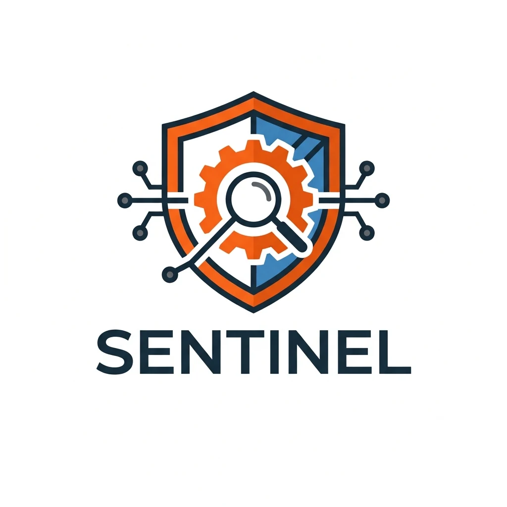
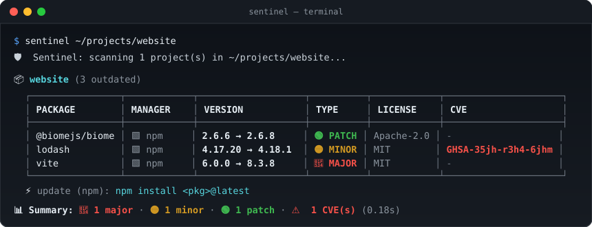

<p align="center">
  
</p>

<h1 align="center">Sentinel</h1>

<p align="center">
  <strong>Blazing-fast, zero-bloat, cross-platform Rust CLI</strong> for multi-ecosystem dependency, license &amp; vulnerability scanning.
</p>

<p align="center">
  <a href="https://www.rust-lang.org/"></a>
  <a href="#installation"></a>
  <a href="https://osv.dev/"></a>
  <a href="LICENSE"></a>
</p>

<p align="center">
  <a href="#-preview">Preview</a> •
  <a href="#-why-sentinel">Why Sentinel</a> •
  <a href="#-supported-ecosystems">Ecosystems</a> •
  <a href="#-installation">Installation</a> •
  <a href="#-usage">Usage</a> •
  <a href="#%EF%B8%8F-configuration">Configuration</a> •
  <a href="#-cicd-integration">CI/CD</a>
</p>

---

## ✨ Preview

<p align="center">
  
</p>

---

## ⚡ Why Sentinel?

- **Instant & Lightweight:** Single native Rust binary with zero runtime dependencies, HTTP Keep-Alive pooling (`rustls`), bounded 16-worker concurrency, and an atomic 15-minute local cache (`~0.01s–0.20s` on cached runs).
- **Direct & Transitive Security:** Parses **12 lockfile formats** natively (no external CLIs or `node_modules` required) and queries [Google OSV](https://osv.dev/) in batches for `CVE`, `GHSA`, `RUSTSEC`, `GO`, and `PYSEC` advisories.
- **License Visibility:** Displays package licenses (`MIT`, `Apache-2.0`, `ISC`, etc.) and highlights copyleft licenses (`GPL`/`AGPL`).
- **CI/CD Ready:** Built-in `--json`, **SARIF 2.1.0** (`--sarif` for GitHub Security), and quality-gate flags (`--fail-on-cve`, `--fail-on-major`).
- **True Cross-Platform:** Runs natively on **Windows** (with automatic UTF-8 console support), **Linux**, and **macOS**.

---

## 🌍 Supported Ecosystems

| Ecosystem | Manifest / Detection | Lockfile (Transitive OSV) | License | OSV Advisories |
| --- | --- | --- | :---: | :---: |
| 🟩 **JS / TS** (`npm`, `pnpm`, `yarn`, `bun`) | `package.json` | `package-lock.json`, `pnpm-lock.yaml`, `yarn.lock` | ✅ | ✅ |
| 🐹 **Go** | `go.mod` | `go.sum` | — | ✅ |
| 🦀 **Rust** (`cargo`) | `Cargo.toml` | `Cargo.lock` | ✅ | ✅ |
| 🐍 **Python** (`uv`, `pip`) | `pyproject.toml`, `requirements.txt` | `uv.lock`, `poetry.lock` | — | ✅ |
| 🐘 **PHP** (`composer`) | `composer.json` | `composer.lock` | — | ✅ |
| 🟣 **.NET** (`dotnet`) | `*.csproj`, `*.fsproj` | `packages.lock.json` | — | ✅ |
| ☕ **Java / Kotlin** (`maven`, `gradle`) | `pom.xml`, `build.gradle(.kts)` | — | — | ✅ |
| 💎 **Ruby** (`bundler`) | `Gemfile` | `Gemfile.lock` | ✅ | ✅ |
| 🐦 **Dart / Flutter** (`pub`) | `pubspec.yaml` | `pubspec.lock` | — | ✅ |
| ⚡ **Elixir** (`hex`) | `mix.exs` | `mix.lock` | ✅ | ✅ |
| 🍎 **Swift / iOS** (`swiftpm`) | `Package.resolved` | — | — | — |
| 🧱 **Terraform** | `.terraform.lock.hcl` | — | — | — |
| 🐳 **Docker** | `Dockerfile`, `docker-compose.yml` | — | — | — |
| 🐙 **GitHub Actions** | `.github/workflows/*.yml` | — | — | — |

---

## 📦 Installation

### From Source (Cargo)

Requires [Rust](https://rustup.rs/) (Edition 2024):

```bash
cargo install --path . --force
```

### Pre-built Binaries

Download the latest release for **Linux (`amd64`)**, **macOS (`arm64`)**, or **Windows (`amd64`)** from the **Releases** page.

---

## 🚀 Usage

```bash
# Scan the current directory (recursively up to 3 levels deep)
sentinel

# Scan a specific workspace
sentinel /path/to/workspace

# Force fresh registry & OSV queries (bypass 15-min cache)
sentinel --no-cache

# Output machine-readable JSON
sentinel --json /path/to/workspace

# Output SARIF 2.1.0 for GitHub Code Scanning
sentinel --sarif /path/to/workspace > sentinel.sarif
```

### CLI Options

| Flag | Description |
| --- | --- |
| `--json` | Output structured JSON to `stdout` |
| `--sarif` | Output SARIF 2.1.0 for GitHub Security tab |
| `--fail-on-cve` | Exit with code `1` if any CVE/GHSA advisory is found |
| `--fail-on-major` | Exit with code `1` if any `MAJOR` update is found |
| `--depth <N>` | Maximum recursive directory depth (default: `3`) |
| `--no-cache` | Bypass the 15-minute local registry & OSV cache |
| `-V`, `--version` | Print version |
| `-h`, `--help` | Print help |

### Environment Variables

| Variable | Description |
| --- | --- |
| `GITHUB_TOKEN` | Optional token for higher GitHub API rate limits when scanning `.github/workflows/*.yml` and `Package.resolved`. |

---

## ⚙️ Configuration

Create an optional `sentinel.toml` in your project or workspace root:

```toml
ignore_packages = ["legacy-pkg", "ureq"]
ignore_dirs = ["examples", "fixtures"]
deny_licenses = ["GPL", "AGPL"]
```

---

## 🔄 CI/CD Integration

Use Sentinel as a fast security gate in GitHub Actions and upload findings directly to **GitHub Security → Code Scanning**:

```yaml
- name: Run Sentinel Security Scan
  run: sentinel --sarif --fail-on-cve . > sentinel.sarif

- name: Upload SARIF to GitHub Security
  if: always()
  uses: github/codeql-action/upload-sarif@v3
  with:
    sarif_file: sentinel.sarif
```

---

## 🏗️ Architecture & Development

Every Rust source file strictly enforces a **<= 70 lines** modular limit (see [AGENTS.md](AGENTS.md)):

```text
src/
├── main.rs            # CLI entry point & parallel orchestration
├── cli.rs             # Argument & flag parser
├── config.rs          # sentinel.toml loader
├── cache.rs           # Atomic 15-minute local disk cache
├── http.rs            # Shared ureq Keep-Alive HTTP agent (rustls)
├── pool.rs            # Bounded 16-worker thread pool
├── discover.rs        # Recursive project discovery
├── osv.rs             # Google OSV batch vulnerability client
├── collectors/        # 14 per-ecosystem collectors
├── lockfiles/         # 12 native lockfile parsers (transitive OSV)
└── output/            # Compact Unicode table, icons & SARIF 2.1.0
```

```bash
cargo fmt --check
cargo clippy --all-targets -- -D warnings
cargo test
cargo build --release
```

---

## 📄 License

Licensed under the **Apache License, Version 2.0** — see [LICENSE](LICENSE) for details.
